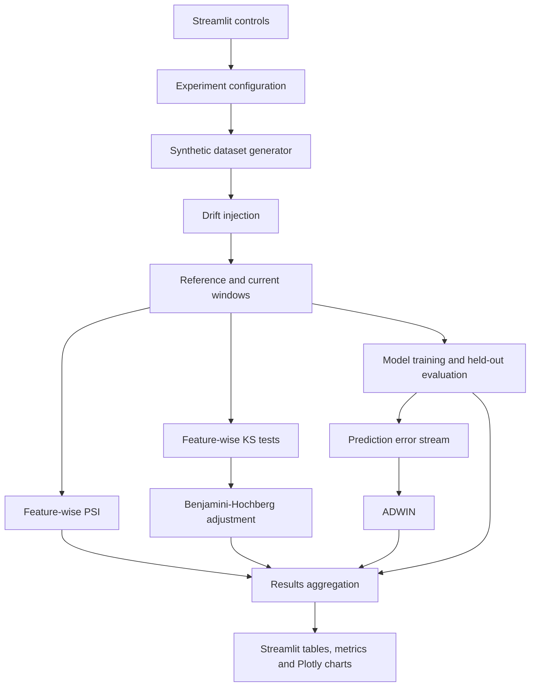

# DriftWatch — System Architecture

## High-level architecture

## Modules

### app.py
Owns the Streamlit user interface, experiment parameters, session-state persistence, feature-wise results table, selected-feature distribution chart and performance display.

### driftwatch/simulation.py
- `make_dataset`: creates a reproducible synthetic binary classification dataset.
- `inject_drift`: applies the selected controlled change after the configured index.
- `evaluate_model`: trains on a reference training subset and evaluates on held-out reference and current samples. Returns metrics and ordered prediction errors.

### driftwatch/detectors.py
- `calculate_psi`: computes PSI using bins learned from reference data.
- `ks_test`: performs a two-sample KS test.
- `benjamini_hochberg`: adjusts p-values across features.
- `analyze_feature_drift`: creates the per-feature comparison table.
- `adwin_test`: monitors the ordered numeric error stream using River ADWIN.

## Data flow

1. User selects experiment settings.
2. A seeded dataset is generated.
3. Drift is injected after the configured change point.
4. Reference and current feature windows are compared independently for every numeric feature.
5. KS p-values are adjusted as a family to reduce false discoveries from multiple feature tests.
6. The model is trained only on reference training samples.
7. Held-out reference errors are concatenated with current-window errors and passed to ADWIN.
8. Streamlit presents distributional evidence and predictive impact as separate concepts.

## Design principles

- Reproducibility through explicit random seeds.
- Reference-only fitting for the predictive model.
- Separation of input drift and predictive-error monitoring.
- Transparent detector scores alongside alert labels.
- Explicit limitations rather than implying that any one detector proves model failure.
